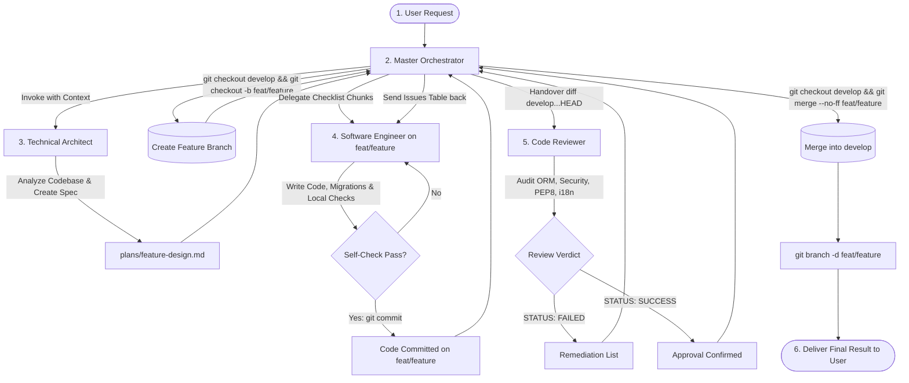

# Multi-Agent Development Workflow (Git Flow & Feedback Loop)

This project strictly utilizes a **Spec-Driven Software Development Life Cycle (SDLC)** integrated with a strict **Git Flow** strategy.

---

## 🔒 Protected Branches Rule

* **`main` and `develop` are strictly protected.**
* **NEVER WRITE CODE DIRECTLY ON `main` OR `develop`.**
* Every task must be performed on a dedicated feature branch: `feat/<feature-name>`.

---

## 🔄 End-to-End Workflow Flowchart

---

## 👥 Role-Based Execution Rules

### 1. The Master Orchestrator (Primary Thread)
* Manages user interaction and coordinates the lifecycle.
* Manages all Git branch operations:
  * Creates feature branches from `develop`: `git checkout -b feat/<name> develop`.
  * Merges feature branch upon approval: `git checkout develop && git merge --no-ff feat/<name>`.
  * Deletes merged branch: `git branch -d feat/<name>`.
* Enforces the feedback loop between Engineer and Reviewer.

### 2. The Technical Architect (`architect`)
* **Mandatory Planning**: Must be invoked for non-trivial features before any code is written.
* Inspects existing models, views, and configurations.
* Outputs the complete blueprint in `plans/<feature-name>-design.md`, specifying the branch name, data models, query optimizations, translation strategy, and todo checklist.

### 3. The Software Engineer (`engineer`)
* Operates strictly on the assigned `feat/<feature-name>` branch.
* Follows the blueprint's Todo Checklist step-by-step.
* Writes Python/Django code, generates migrations, updates templates, and verifies with `python manage.py check`.
* Commits all changes on the feature branch.
* If review fails, resolves all reported issues immediately on the same branch.

### 4. The Code Reviewer (`reviewer`)
* Audits the feature branch using `git diff develop...HEAD`.
* Verifies:
  1. Django ORM performance (N+1 queries, `select_related`/`prefetch_related`).
  2. Security (CSRF tokens, no credentials in code).
  3. Translations (`django-modeltranslation`, `gettext_lazy`, template tags).
  4. System health (`python manage.py check`).
* Emits an explicit verdict: `[STATUS: SUCCESS]` or `[STATUS: FAILED]`.

---

## 🔁 The Review Feedback Loop

1. When the Engineer completes implementation, the Orchestrator invokes the Reviewer.
2. If the Reviewer returns `[STATUS: FAILED]`:
   - The Orchestrator forwards the Reviewer's **Issues Table** back to the Engineer.
   - The Engineer applies fixes on the feature branch, commits them, and re-submits.
   - The Reviewer audits the updated diff.
   - This cycle repeats until the Reviewer confirms `[STATUS: SUCCESS]`.
3. Once approved:
   - The Orchestrator switches to `develop`, merges the feature branch, deletes it, and notifies the user.
