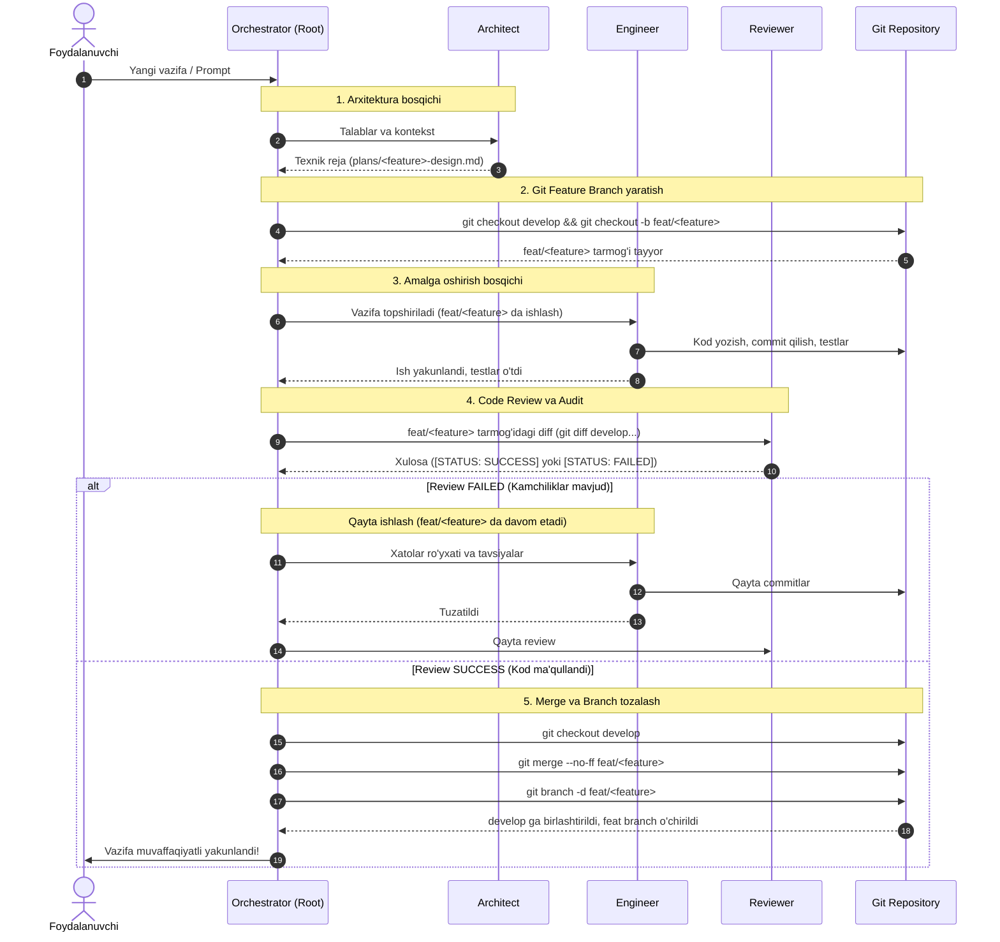

# Reja (v2): Firdowear Multi-Agent Tizimi va Git Branching Oqimi

Ushbu yangilangan reja `firdowear` loyihasida 4 bosqichli agentlar jamoasini (**Orchestrator → Architect → Engineer → Reviewer**) qat'iy **Git Branching Strategy** (Git Flow) qoidasi bilan integratsiya qiladi.

---

## 1. Asosiy Qoidalar (Git Branching Policy)

1. `main` va `develop` asosiy himoyalangan tarmoqlar (protected branches) hisoblanadi. Ularda **hech qachon to'g'ridan-to'g'ri kod yozilmaydi yoki to'g'ridan-to'g'ri commit qilinmaydi**.
2. Har bir yangi vazifa uchun `develop` tarmog'idan alohida `feat/<feature-nomi>` tarmog'i ochiladi.
3. **Engineer** barcha kodlarni va dastlabki testlarni faqat shu `feat/<feature-nomi>` tarmog'ida amalga oshiradi.
4. **Reviewer** kodni `develop` bilan solishtirib (`git diff develop...feat/<nomi>`) to'liq audit qiladi.
5. **Review muvaffaqiyatli bo'lsa (`[STATUS: SUCCESS]`)**:
   - `feat/<feature-nomi>` tarmog'i `develop` ga merge qilinadi (`git merge --no-ff`).
   - Feature branch o'chirib tashlanadi (`git branch -d feat/<feature-nomi>`).
6. **Review muvaffaqiyatsiz bo'lsa (`[STATUS: FAILED]`)**:
   - Tarmoq saqlanib qoladi, xatolar ro'yxati bilan `engineer` ga qaytariladi va shu tarmoqda tuzatishlar davom ettiriladi.

---

## 2. To'liq Oqim Diagrammasi

---

## 3. Fayllardagi O'zgarishlar

1. **Tozalash**:
   - `.agents/agents/contract-writter/` o'chiriladi.
   - `.agents/rules/best-practices-adk.md` o'chiriladi.
   - `.agents/skills/AGENTS.md` va HTML fayllar o'chiriladi.

2. **`.agents/AGENTS.md`**:
   - `firdowear` ning Django 5 xususiyatlari va jamoa yo'riqnomasi.
   - Git Branching Policy qoidalari.

3. **`engineer/agent.md`**:
   - Har bir ish faqat `feat/<nomi>` tarmog'ida olib borilishi sharti.
   - `main` yoki `develop` da kod yozish qat'iy taqiqlanishi.

4. **`reviewer/agent.md`**:
   - O'zgarishlarni `git diff develop...HEAD` orqali tekshirish.
   - Natija formati: `[STATUS: SUCCESS]` yoki `[STATUS: FAILED]`.

5. **`multi-agent-workflow.md`**:
   - Butun siklni boshqarish qoidasi: branch ochish → reja → kodlash → review → merge develop → branch delete.
